# Arquitectura

Cómo está organizado el frontend y por qué. La idea central es simple: **las pantallas no saben de dónde vienen los datos**. Hablan con servicios, y los servicios deciden si responden con datos simulados o con la API real.

**En esta página:** [Capas](#las-capas) · [Estructura de carpetas](#estructura-de-carpetas) · [Rutas](#rutas-de-la-aplicación) · [Estado global](#estado-global) · [Reglas de dependencia](#reglas-de-dependencia)

---

## Las capas



| Capa | Responsabilidad | Qué NO debe hacer |
| :--- | :--- | :--- |
| **Páginas** (`feature/*`) | Componer la pantalla y manejar sus estados (cargando, error, vacío) | Llamar a `fetch` o importar JSON |
| **Componentes** (`shared/components`) | Piezas visuales reutilizables | Conocer reglas de negocio de una pantalla |
| **Contextos** (`core/context`) | Estado compartido entre pantallas (carrito, avisos) | Guardar datos que solo usa una pantalla |
| **Servicios** | Único punto de acceso a datos y reglas de pedido | Renderizar interfaz |
| **`apiClient`** | `fetch` con manejo de errores uniforme | Saber qué endpoint es de quién |

## Estructura de carpetas

```text
frontend/src/
├── core/
│   ├── api/          apiClient.js: fetch, errores y el interruptor VITE_USE_MOCK
│   ├── context/      CartContext y ToastContext
│   └── routes/       AppRouter.jsx (HashRouter)
├── feature/          una carpeta por módulo de negocio
│   ├── home/         Portada
│   ├── catalog/      Catálogo, detalle de producto y catalogService (+ mockCatalog.json)
│   ├── checkout/     Checkout, confirmación, orderService y esquema de validación
│   ├── tracking/     Seguimiento de pedido (timeline)
│   └── system/       Página 404
└── shared/
    ├── components/   Button, Input, Badge, Modal, EmptyState, ProductCard, Header, Footer...
    ├── constants/    Líneas de negocio, estados de pedido, datos de contacto
    └── utils/        formatters, validators y zodResolver
```

> [!TIP]
> **Regla para decidir dónde va un archivo.** Si solo lo usa un módulo, vive dentro de `feature/<módulo>`. Si lo usan dos o más, súbelo a `shared`. No lo muevas a `shared` "por si acaso": se hace cuando aparece el segundo uso.

## Rutas de la aplicación

La app usa `HashRouter`, así que cada ruta real se ve como `/#/ruta`.

| Ruta | Módulo | Pantalla |
| :--- | :--- | :--- |
| `/` | M1 | Portada |
| `/catalogo` y `/catalogo/:linea` | M2 | Catálogo (general o por línea) |
| `/producto/:slug` | M3 | Detalle de producto |
| *(drawer, sin ruta)* | M4 | Carrito lateral |
| `/checkout` | M5 | Formulario de compra |
| `/checkout/confirmacion?codigo=...` | M6 | Pedido recibido |
| `/pedido/:codigo` | M7 | Seguimiento |
| *(paleta, sin ruta)* | M8 | Búsqueda global |
| `*` | M9 | Página 404 |

> [!NOTE]
> **No confundas hito con módulo.** Los hitos de GitHub se llaman M1 a M4 y agrupan entregas. Los módulos M1 a M9 de esta tabla son las pantallas de la guía de estilo. Por ejemplo, el hito "M4: Checkout y Seguimiento" contiene los módulos M5, M6 y M7.

## Estado global

Hay solo dos contextos, y es a propósito. No se necesita nada más pesado.

**`CartContext`** guarda el carrito y lo persiste en `localStorage` (clave `prisma_store_cart_v1`). Si el almacenamiento está bloqueado, sigue funcionando en memoria sin lanzar errores.

| Función | Qué hace |
| :--- | :--- |
| `addItem(variantId, quantity)` | Agrega una variante respetando el stock disponible |
| `updateQuantity(variantId, qty)` | Cambia la cantidad; con 0 o menos, elimina el artículo |
| `removeItem(variantId)` | Quita un artículo |
| `clear()` | Vacía el carrito (se usa al completar un pedido) |
| `items`, `totalItems`, `subtotal` | Datos derivados para mostrar |

**`ToastContext`** muestra avisos breves (`success`, `warning`, `error`, `info`) que se cierran solos a los 3,5 segundos.

## Reglas de dependencia

Estas reglas mantienen el código fácil de cambiar:

1. Un módulo de `feature/` **no importa archivos internos de otro módulo**. Si necesita algo, lo toma de su `index.js` público o de `shared`.
2. `shared` **no importa de `feature`**. La dependencia va siempre hacia adentro.
3. Los componentes **no importan JSON ni llaman a `fetch`**. Todo pasa por un servicio.
4. Los colores, radios y tipografías **salen de los tokens de `index.css`**, no de hexadecimales sueltos.

---

Siguiente: [Módulos e issues](Modulos-e-Issues)
