# CI/CD

Qué revisa el sistema automático cada vez que abres un PR, cómo leer sus resultados y cómo llega el código a Vercel.

**En esta página:** [Visión general](#visión-general) · [Qué corre y cuándo](#qué-corre-y-cuándo) · [Leer los resultados](#leer-los-resultados) · [Despliegue](#despliegue-en-vercel) · [Configuración](#configuración-del-repositorio) · [Mantenimiento](#mantenimiento)

---

## Visión general

El pipeline está hecho con **GitHub Actions** y vive en `.github/workflows/`. Su trabajo es doble: **proteger** (que nada roto llegue a `develop` o `main`) y **entregar** (publicar en Vercel sin pasos manuales).

## Qué corre y cuándo

### Verificaciones (en cada PR y en cada push a `develop` o `main`)

| Job | Qué comprueba | ¿Bloquea? |
| :--- | :--- | :-: |
| **Política de ramas** | Que un PR hacia `main` venga de `develop` | Sí |
| **Higiene del PR** | Título con Conventional Commits; aviso si falta `Closes #N` | Título sí, `Closes` solo avisa |
| **Lint** | `oxlint` sobre el código | Sí |
| **Pruebas (Node 20 y 22)** | Pruebas unitarias con cobertura mínima | Sí |
| **Compilación** | `vite build` y presupuesto de peso del bundle (900 KB de JS) | Sí |
| **Auditoría de dependencias** | `npm audit` de severidad alta o crítica | Sí |
| **Escaneo de secretos** | Credenciales en el código y archivos `.env` versionados | Sí |
| **Lint de workflows** | `actionlint` sobre los propios workflows | Sí |
| **Lighthouse** | Rendimiento y accesibilidad del build | No, es informativo |
| **Revisión de dependencias** | Dependencias nuevas con vulnerabilidades (opcional) | No |
| **CodeQL** | Análisis estático de seguridad del código | Sí, si hay alertas nuevas |
| **CI aprobado** | Resumen: pasa solo si todos los requeridos pasaron | Es el check obligatorio |

### Entrega

| Evento | Qué ocurre |
| :--- | :--- |
| PR de la misma repo | Vista previa en Vercel con un comentario con la URL |
| Push a `develop` | Despliegue a **staging** |
| Push a `main` | **Aprobación manual** y despliegue a **producción**, más un Release con notas |

Los despliegues están **apagados por defecto**: se activan con la variable del repositorio `VERCEL_DEPLOY=true`. Sin ella, el pipeline solo verifica.

## Leer los resultados

### El comentario del PR

Cuando termina el CI, el bot deja **un solo comentario** y lo va actualizando en cada commit nuevo.

**Si todo pasó:**

> Todo en orden: las verificaciones pasaron en el commit a1b2c3d. Detalle en el run completo.

**Si algo falló:**

> El CI falló en el commit a1b2c3d. Esto es lo que hay que revisar:
>
> - Pruebas (Node 22): falló en "Pruebas unitarias con cobertura" (logs). Corre npm run test:ci dentro de frontend. Si todas pasan, revisa que no haya bajado la cobertura.

Cada línea trae el job, el paso exacto que falló, el enlace a los logs y una pista para reproducirlo localmente.

### Qué hacer según el fallo

| Job que falla | Causa habitual | Cómo resolverlo |
| :--- | :--- | :--- |
| Política de ramas | PR hacia `main` desde una rama de trabajo | Cierra el PR y ábrelo hacia `develop` |
| Higiene del PR | Título sin formato Conventional Commits | Edita el título: `feat(alcance): descripción` |
| Lint | Código con errores de `oxlint` | `cd frontend && npm run lint` y corrige |
| Pruebas | Una prueba falla, o la cobertura bajó del umbral | `npm run test:ci`; agrega pruebas a lo nuevo |
| Compilación | Error de build o bundle sobre 900 KB | `npm run build`; reduce el peso si es el presupuesto |
| Auditoría | Dependencia con vulnerabilidad alta | `npm audit --omit=dev` y actualiza el paquete |
| Escaneo de secretos | Una credencial o un `.env` en el repo | Quítalo y **cambia la clave expuesta** |
| CodeQL | Una alerta de seguridad en el código nuevo | Mira el comentario en línea del PR y corrige el patrón |

> [!NOTE]
> **El comentario de CodeQL aparece en inglés.** Lo escribe GitHub, no nuestros workflows, y no se puede traducir. Todo lo demás del CI está en español.

> [!TIP]
> **Reproduce siempre en local primero.** `cd frontend && npm run lint && npm run test:ci && npm run build` ejecuta lo mismo que el CI. Si pasa en tu máquina y falla en el CI, normalmente es una diferencia de versión de Node o un archivo que no subiste.

## Despliegue en Vercel

El despliegue se hace con la CLI de Vercel desde GitHub Actions (modo *prebuilt*), de modo que **lo que pasó por el CI es exactamente lo que se publica**.

1. Descarga la configuración del proyecto de Vercel.
2. Compila con las variables de entorno del entorno correspondiente.
3. Despliega el resultado.
4. Hace una **prueba de humo**: pide la URL publicada y exige respuesta correcta (reintenta 3 veces mientras se propaga).

| Entorno | Destino | Aprobación |
| :--- | :--- | :--- |
| `staging` | Vista previa de Vercel | No |
| `production` | Producción de Vercel | **Sí**, manual |

`frontend/vercel.json` agrega caché larga a `/assets` y cabeceras de seguridad (`X-Content-Type-Options`, `X-Frame-Options`, `Referrer-Policy`).

## Configuración del repositorio

Lo configura quien administra el repositorio (requiere rol de administrador).

| Dónde | Qué | Nombre |
| :--- | :--- | :--- |
| Settings, Secrets and variables, Actions, **Secrets** | Credenciales de Vercel | `VERCEL_TOKEN`, `VERCEL_ORG_ID`, `VERCEL_PROJECT_ID` |
| Settings, Secrets and variables, Actions, **Variables** | Activar despliegues | `VERCEL_DEPLOY=true` |
| Variables (opcionales) | Valores del build | `VITE_API_URL`, `VITE_USE_MOCK`, `VITE_WHATSAPP_NUMBER`, `DEPENDENCY_REVIEW` |
| Settings, Environments | Entornos de despliegue | `staging` y `production` (con revisor) |
| Settings, Branches | Protección y rama por defecto | Ver [Flujo de trabajo con Git](Flujo-de-Trabajo-Git) |

**Cómo obtener los datos de Vercel:**

1. Crea una cuenta en vercel.com.
2. Dentro de `frontend/` ejecuta `npx vercel link`: crea el proyecto y genera `.vercel/project.json` con el `orgId` y el `projectId`. Esa carpeta ya está en el `.gitignore`.
3. Crea un token en la configuración de tu cuenta de Vercel: ese es `VERCEL_TOKEN`.
4. Deja el **Root Directory del proyecto vacío**: la CLI corre dentro de `frontend/`.

> [!WARNING]
> Los secretos pertenecen a la cuenta de Vercel que los generó. Si el despliegue final va a la cuenta de otra persona, que ella cree el token y el proyecto.

## Mantenimiento

- **Dependabot** abre cada semana PRs hacia `develop` con actualizaciones de npm y de las acciones de GitHub.
- **Versiones de las acciones.** Se mantienen en sus últimas versiones mayores. Si GitHub muestra advertencias de runtime obsoleto (por ejemplo, "Node.js 20 is deprecated"), no son de nuestro código: son de las acciones y se resuelven subiendo su versión.
- **CodeQL** se ejecuta además cada lunes, aunque nadie abra un PR.
- Cuando cambies un workflow, valídalo antes con `actionlint` (`brew install actionlint`).

---

Siguiente: [Pruebas y calidad](Pruebas-y-Calidad)
