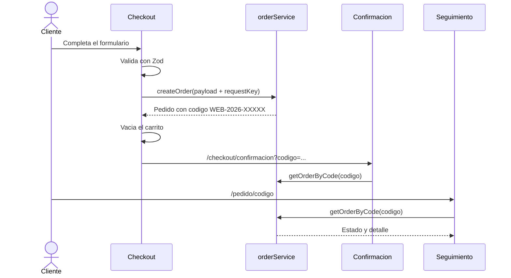

# Checkout y seguimiento

Cómo funciona, por dentro, el tramo final de la compra: el formulario, la confirmación y el seguimiento. Corresponde a los issues **#9, #10 y #11** (hito M4).

**En esta página:** [Visión general](#visión-general) · [Checkout](#checkout-issue-9) · [Confirmación](#confirmación-issue-10) · [Seguimiento](#seguimiento-issue-11) · [El servicio de pedidos](#el-servicio-de-pedidos) · [Cómo probarlo](#cómo-probarlo)

---

## Visión general

---

## Checkout (issue #9)

Archivo: `feature/checkout/CheckoutPage.jsx`. Esquema: `feature/checkout/checkoutSchema.js`.

### Diseño de la pantalla

| Pantalla | Distribución |
| :--- | :--- |
| Escritorio (`lg` en adelante) | Formulario a la izquierda (7/12) y resumen a la derecha (5/12), con el resumen fijo al hacer scroll |
| Móvil | Resumen **colapsable** arriba (muestra el total aunque esté cerrado) y formulario debajo |

### Campos y reglas de validación

La validación vive en un esquema de **Zod**, no dentro del componente. Así se puede probar sin abrir un navegador.

| Campo | Regla | Mensaje al usuario |
| :--- | :--- | :--- |
| Nombre completo | Mínimo 3 caracteres, solo letras y tildes (`validateName`) | Ingresa tu nombre completo (mínimo 3 letras, sin números). |
| Teléfono celular | 9 dígitos y empieza con 9: `^9\d{8}$` (`validatePhone`) | Ingresa un celular peruano válido (9 dígitos, empieza con 9). |
| Dirección | Mínimo 5 caracteres | Ingresa una dirección de entrega válida. |
| Referencia | Opcional, máximo 160 caracteres | La referencia es demasiado larga. |
| Ámbito de entrega | `LOCAL` (Huánuco) o `NACIONAL` (provincias) | Selecciona el ámbito de entrega. |
| Método de pago | `YAPE`, `PLIN`, `TARJETA` o `EFECTIVO` | Selecciona un método de pago. |

> [!TIP]
> **El teléfono se limpia mientras escribes.** Si pegas `987-654 321`, el campo deja solo `987654321` y corta a 9 dígitos. La validación nunca ve basura.

### Envío del pedido

Estas son las protecciones que tiene el botón "Confirmar pedido":

1. **Se deshabilita mientras envía** y muestra "Enviando pedido..." con un indicador de carga.
2. **`requestKey` único.** Se genera una vez al abrir el checkout (con `crypto.randomUUID`). Si el cliente reintenta el mismo pedido tras un error, se reenvía la misma clave, y el backend puede reconocer que es el mismo intento en lugar de crear un duplicado.
3. **Vaciado del carrito solo si salió bien.** Un error no pierde lo que el cliente armó.
4. **Redirección** a `/checkout/confirmacion?codigo=WEB-2026-XXXXX`, reemplazando la entrada del historial para que "atrás" no regrese al formulario.
5. **Errores visibles dos veces**: un aviso (toast) y un mensaje fijo sobre el botón, con `role="alert"`.

### Protección de ruta

Si el carrito está vacío, `/checkout` redirige a `/catalogo`. Hay un detalle sutil: al terminar un pedido, el carrito **se vacía antes de navegar**, y sin cuidado eso dispararía esa misma redirección. Una marca interna (`completedRef`) la desactiva justo después de un pedido exitoso.

---

## Confirmación (issue #10)

Archivo: `feature/checkout/OrderConfirmationPage.jsx`.

La pantalla muestra, en este orden:

1. Ícono de confirmación en color `emerald` y el título "¡Pedido recibido!".
2. El **código del pedido destacado** (`WEB-2026-XXXXX`) en una caja verde.
3. Resumen completo: cliente, celular, dirección, referencia, ámbito de entrega, método de pago y productos con total.
4. Tarjeta "Siguientes pasos" con el botón **Escribir por WhatsApp**, que abre una conversación con el mensaje ya redactado e incluye el código del pedido.
5. Dos botones de navegación: **Seguir comprando** (`/catalogo`) y **Ver estado del pedido** (`/pedido/:codigo`).

> [!NOTE]
> **El código viaja en la URL** (`?codigo=`), no solo en memoria. Por eso un refresco de página no pierde el pedido. En modo mock, el pedido vive en memoria de la sesión, así que tras refrescar verás "No encontramos tu pedido". Con la API real esto no ocurre.

Casos que cubre: sin código en la URL, código que no existe, y carga con esqueletos mientras responde el servicio.

---

## Seguimiento (issue #11)

Archivo: `feature/tracking/OrderTrackingPage.jsx`. Línea de tiempo: `feature/tracking/components/OrderTimeline.jsx`.

### Qué muestra

- **Buscador** para escribir cualquier código de pedido (se normaliza a mayúsculas).
- **Cabecera** con el código, la fecha y un badge con el estado actual.
- **Timeline vertical** con las etapas completadas, la actual y las pendientes.
- **Detalle** de productos y datos del cliente, y, si aplica, **courier y número de tracking**.

### Estados del pedido

| Estado | Etiqueta | Color del badge | Significado |
| :--- | :--- | :--- | :--- |
| `PENDING` | Pendiente | Ámbar | Recibimos el pedido y se valida el pago |
| `PREPARING` | En preparación | Cian | Se están empacando los productos |
| `SHIPPED` | Enviado | Púrpura | Va en camino |
| `DELIVERED` | Entregado | Verde | El cliente ya lo recibió |
| `CANCELLED` | Cancelado | Rojo | Se muestra aparte, fuera del flujo normal |

> [!NOTE]
> El diagrama muestra el flujo esperado del negocio. El frontend **no decide** las transiciones: solo muestra el estado que le entrega el servicio. Las reglas de cuándo se puede cancelar pertenecen al backend.

### Estados de la pantalla

| Situación | Qué ve el usuario |
| :--- | :--- |
| Cargando | Esqueletos (`react-loading-skeleton`) |
| Sin código en la URL | Mensaje para ingresar el código, con su formato |
| Código inexistente (404) | "Pedido no encontrado" con botón **Reintentar** |
| Error de red | "No pudimos cargar tu pedido" con botón **Reintentar** |

La línea de tiempo es accesible: cada paso indica si está completado, actual o pendiente para lectores de pantalla, y el paso vigente lleva `aria-current="step"`.

---

## El servicio de pedidos

Archivo: `feature/checkout/services/orderService.js`. Es el único lugar que sabe cómo se crea y se consulta un pedido.

| Función | Qué hace |
| :--- | :--- |
| `createOrder(payload)` | Valida el pedido, calcula precios desde el catálogo y devuelve el pedido con su código |
| `getOrderByCode(code)` | Busca un pedido por código; lanza un error con `status = 404` si no existe |

**Validaciones del servicio.** Aunque el formulario ya valida, el servicio vuelve a hacerlo: nombre, teléfono, dirección y carrito no vacío. Nunca se confía solo en la interfaz.

**Precios.** El servicio recalcula cada precio con `findVariantInCatalog`, en vez de aceptar el que manda el navegador. La cantidad mínima es 1.

### Modo mock

En modo mock, los códigos se generan correlativos (`WEB-2026-00001`, `00002`...) y los pedidos viven en memoria. Además existen **pedidos demo** para explorar cada estado sin hacer una compra:

| Código | Estado | Extra |
| :--- | :--- | :--- |
| `WEB-2026-00001` | `PENDING` | |
| `WEB-2026-00002` | `PREPARING` | |
| `WEB-2026-00003` | `SHIPPED` | Olva Courier, tracking `OLV-884210` |
| `WEB-2026-00004` | `DELIVERED` | Olva Courier, tracking `OLV-770123` |
| `WEB-2026-00005` | `CANCELLED` | |

> [!NOTE]
> Los pedidos creados en la sesión tienen prioridad sobre los demo cuando comparten código (el correlativo mock también empieza en `00001`).

> [!WARNING]
> Los endpoints reales (`POST /api/public/orders` y `GET /api/public/orders/:codigo`) son **provisionales** hasta que el backend confirme los definitivos.

---

## Cómo probarlo

1. Levanta el proyecto con `npm run dev` (ver [Primeros pasos](Primeros-pasos)).
2. **Flujo completo:** agrega un producto al carrito, entra a `/#/checkout`, llena el formulario y confirma.
3. **Solo el seguimiento:** abre directamente
   - `/#/pedido/WEB-2026-00003` para un pedido enviado,
   - `/#/pedido/WEB-2026-00005` para uno cancelado,
   - `/#/pedido/WEB-2026-99999` para ver el "no encontrado".
4. **Pruebas automáticas:** `npm test` ejecuta, entre otras, las del esquema del checkout y las del servicio de pedidos.

---

Siguiente: [Guía de estilo](Guia-de-Estilo)
