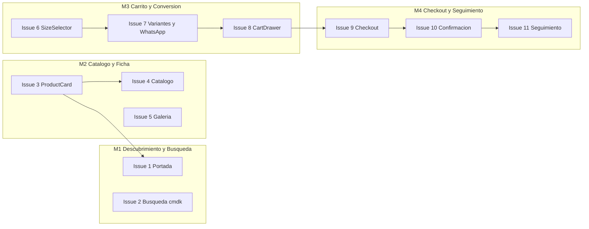

# Equipo y reparto

Quién se encarga de qué, y cómo trabajamos juntos para que cuatro personas avancen en paralelo sin pisarse.

**En esta página:** [El equipo](#el-equipo) · [Reparto por persona](#reparto-por-persona) · [Cómo evitar pisarnos](#cómo-evitar-pisarnos) · [Comunicación](#comunicación-y-acuerdos) · [Definición de terminado](#definición-de-terminado)

---

## El equipo

| Persona | Rol | Hito | Foco |
| :--- | :--- | :-: | :--- |
| **Melissa-stars** | Desarrolladora 1 | M1 | Descubrimiento: portada y búsqueda global |
| **O3rosamateo** | Desarrolladora 2 | M2 | Exploración: catálogo y ficha de producto |
| **Luis-Mauricio765** | Desarrollador 3 | M3 | Conversión: variantes, carrito y WhatsApp |
| **LeoSle4** | Desarrollador 4 | M4 | Compra: checkout, confirmación y seguimiento |

## Reparto por persona

Las flechas indican **dependencias naturales**: por ejemplo, la portada y el catálogo reutilizan `ProductCard`, y el checkout parte de un carrito que ya funciona.

### Detalle por persona

**Melissa-stars (M1)**
- Issue #1: Portada con Hero, colecciones y novedades.
- Issue #2: Paleta de búsqueda con `cmdk`.
- *Servicios que usa:* `catalogService.getProducts()` y la búsqueda con debounce.

**O3rosamateo (M2)**
- Issue #3: `ProductCard` con estados de stock.
- Issue #4: Catálogo con filtros y ordenamiento.
- Issue #5: Galería 3:4 en el detalle.
- *Servicios que usa:* `catalogService.getProducts()` con parámetros de filtro.

**Luis-Mauricio765 (M3)**
- Issue #6: `SizeSelector` accesible.
- Issue #7: Variantes, WhatsApp y barra fija móvil.
- Issue #8: `CartDrawer` con `CartContext`.
- *Estado que maneja:* `CartContext` y los límites de stock.

**LeoSle4 (M4)**
- Issue #9: Checkout con react-hook-form y Zod.
- Issue #10: Confirmación con código correlativo.
- Issue #11: Seguimiento con timeline.
- *Servicios que usa:* `orderService` (crear y consultar).

## Cómo evitar pisarnos

1. **Cada quien en su carpeta.** El reparto sigue las carpetas de `feature/`, así que casi nunca se toca el mismo archivo.
2. **Los componentes compartidos tienen dueño.** `ProductCard` es de O3rosamateo y `SizeSelector` de Luis-Mauricio765. Si necesitas un cambio ahí, abre un issue o coméntalo en el PR, y no lo edites por tu cuenta.
3. **Integra seguido.** Mientras más tiempo vive una rama sin integrarse a `develop`, más difícil es el merge. PRs pequeños y frecuentes.
4. **Actualiza tu rama con `develop`** antes de pedir revisión.
5. **Lo compartido va a `shared`.** Si necesitas algo de otro módulo, súbelo a `shared` en un PR propio; no importes archivos internos de otra feature.

## Comunicación y acuerdos

- **El issue es la fuente de verdad** de qué se construye. Si cambia el alcance, se actualiza el issue.
- **Pregunta pronto.** Quince minutos atascado cuestan más que una pregunta.
- **Revisiones cruzadas.** Cada PR lo revisa alguien distinto de quien lo escribió. Se prioriza revisar antes de empezar algo nuevo.
- **Las decisiones importantes se escriben** en [Decisiones técnicas](Decisiones-Tecnicas).
- **Los errores se tratan como aprendizaje**, no como culpa. Si el CI se puso rojo, se arregla y, si enseña algo, se documenta en [Solución de problemas](Solucion-de-Problemas).

## Definición de terminado

Un issue está **terminado** cuando cumple todo esto, no antes:

- [ ] Cumple los criterios de aceptación del issue.
- [ ] Contempla los estados de cargando, error y vacío.
- [ ] Se ve y se usa bien en móvil (375 px) y en escritorio.
- [ ] Es accesible: teclado, foco visible, etiquetas y zonas táctiles de 44 px.
- [ ] Las pruebas cubren la lógica nueva.
- [ ] `npm run lint`, `npm run test:ci` y `npm run build` pasan.
- [ ] El PR está revisado, aprobado y con el CI en verde.
- [ ] La documentación (esta wiki o `docs/`) refleja el cambio.
- [ ] El issue está cerrado, con el PR que lo resolvió.

---

Volver al [inicio](Home)
