# Flujo de trabajo con Git

Cómo pasa un cambio desde tu computadora hasta producción, y las reglas que evitan que algo roto llegue a `main`.

**En esta página:** [El modelo de ramas](#el-modelo-de-ramas) · [Paso a paso](#paso-a-paso-de-una-tarea) · [Nombres de ramas](#nombres-de-ramas) · [Commits](#commits) · [Pull requests](#pull-requests) · [Cerrar issues](#cerrar-issues) · [Merge](#cómo-se-hace-el-merge) · [Protección](#protección-de-ramas)

---

## El modelo de ramas



| Rama | Para qué sirve | ¿Se trabaja directo? |
| :--- | :--- | :--- |
| `main` | Lo que está en producción | No. Solo recibe PRs desde `develop` |
| `develop` | Integración: aquí se juntan todas las tareas | No. Solo recibe PRs desde ramas de trabajo |
| `feat/...`, `fix/...`, `ci/...` | Una tarea concreta | Sí |

> [!IMPORTANT]
> **Nunca se hace push directo a `main` ni a `develop`.** Todo entra por Pull Request, con el CI en verde.

## Paso a paso de una tarea

1. **Toma un issue** asignado a ti y léelo completo, incluidos los criterios de aceptación.
2. **Actualiza `develop` y crea tu rama** desde ahí:
   ```bash
   git switch develop
   git pull --ff-only
   git switch -c feat/descripcion-corta
   ```
3. **Trabaja en commits pequeños** (ver más abajo).
4. **Antes de subir**, corre lo mismo que el CI:
   ```bash
   cd frontend && npm run lint && npm run test:ci && npm run build
   ```
5. **Sube la rama y abre el PR hacia `develop`**, con `Closes #N` en la descripción.
6. **Revisa el comentario del CI** en tu PR. Si algo falló, te dice qué y cómo corregirlo.
7. **Pide revisión** a un compañero y atiende sus comentarios con commits nuevos.
8. **Merge** cuando haya aprobación y el CI esté en verde.

## Nombres de ramas

Formato: `tipo/descripcion-corta-en-kebab`, en inglés y en minúsculas.

| Tipo | Ejemplo |
| :--- | :--- |
| `feat/` | `feat/checkout-form` |
| `fix/` | `fix/cart-quantity-limit` |
| `ci/` | `ci/actualiza-acciones` |
| `docs/` | `docs/wiki` |
| `chore/` | `chore/update-deps` |

**Una rama = una preocupación.** Si descubres otro problema mientras trabajas, anótalo y ábrelo como otra rama.

## Commits

Usamos **Conventional Commits**: `tipo(alcance): verbo en presente`. El mensaje va en español; el código y los nombres, en inglés.

```text
feat(checkout): agrega esquema zod y resolver para el formulario (#9)
fix(tracking): usa un Map para los pedidos demo (#11)
ci(deps): actualiza las acciones de GitHub a versiones con Node 24
docs(ci): documenta el pipeline y el reporte de fallos
```

| Tipo | Cuándo |
| :--- | :--- |
| `feat` | Una funcionalidad nueva |
| `fix` | Corregir un error |
| `refactor` | Reorganizar código sin cambiar el comportamiento |
| `test` | Agregar o ajustar pruebas |
| `docs` | Solo documentación |
| `ci` | Pipelines y automatización |
| `chore` | Mantenimiento (dependencias, configuración) |
| `style` | Formato, sin cambio de lógica |
| `perf` | Mejoras de rendimiento |

**Buenas prácticas de commit:**

- **Menos de 400 líneas cambiadas** por commit. Si crece, divídelo por comportamiento.
- **Código, pruebas y documentación del mismo cambio van juntos.** No separes "el código" de "sus tests".
- **Máximo 72 caracteres** en el asunto, sin punto final.
- **Agrega solo los archivos que corresponden** (`git add ruta/archivo`), nunca `git add .` a ciegas: así no se cuela un `.env` ni un archivo temporal.
- El cuerpo del commit, si hace falta, explica **por qué**, no qué.

## Pull requests

La plantilla ya viene precargada. Completa estas partes:

```markdown
## Qué hace
Una o dos frases claras.

Closes #9

## Decisiones
- Qué elegiste y por qué.

## Cómo probarlo
Los pasos para verlo funcionar.
```

**Checklist antes de pedir revisión:**

- [ ] Apunta a `develop` (solo `develop` va a `main`).
- [ ] El **título sigue Conventional Commits** (el CI lo verifica).
- [ ] Tiene `Closes #N` con el issue correcto.
- [ ] Tiene el mismo **hito y etiquetas** que el issue, y está asignado a quien lo desarrolló.
- [ ] El CI está en verde y los tests cubren lo nuevo.

**Un PR, un issue.** Es más fácil de revisar, de revertir y de entender meses después.

## Cerrar issues

Para que GitHub cierre el issue y lo enlace al PR, la descripción del PR debe incluir una de estas palabras seguidas del número:

```text
Closes #9
Fixes #9
Resolves #9
```

> [!WARNING]
> GitHub **solo cierra el issue cuando el PR se fusiona en la rama por defecto del repositorio**. Si la rama por defecto es `main` y tu PR va a `develop`, el issue no se cierra solo. Mientras eso no cambie, el PR de `develop` a `main` debe repetir los `Closes #N`, o se cierran a mano con un comentario que indique el PR (`Resuelto en #17.`).

## Cómo se hace el merge

| Situación | Tipo de merge |
| :--- | :--- |
| PR de una tarea hacia `develop` | **Merge commit** |
| PRs apilados (uno parte de la rama del otro) | **Siempre merge commit**, en orden |
| PR de `develop` hacia `main` | **Merge commit** |

> [!TIP]
> **¿Por qué no squash?** Cuando una rama parte de otra (PRs apilados), el squash reescribe los commits y la segunda rama arrastra duplicados o conflictos. Con merge commit la historia queda intacta y cada PR muestra solo lo suyo.

**Si trabajas con PRs apilados**, mergéalos en orden. Después de fusionar el primero, el segundo puede quedar "desactualizado": usa el botón *Update branch* y espera de nuevo al CI.

## Protección de ramas

Configuración recomendada para `develop` y `main` (la hace quien administra el repositorio):

| Regla | Valor |
| :--- | :--- |
| Exigir Pull Request antes de fusionar | Sí |
| Aprobaciones requeridas | 1 |
| Checks obligatorios | `CI aprobado` y `Política de ramas` |
| Rama al día con la base | Sí |
| Resolver conversaciones antes del merge | Sí |
| Force push y borrado de la rama | Bloqueados |
| Rama por defecto del repositorio | `develop` |

---

Siguiente: [CI/CD](CI-CD)
