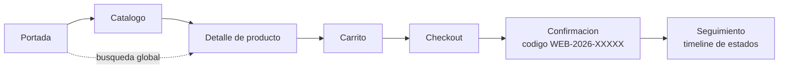

<h1 align="center">Tienda Prisma</h1>

  <strong>E-commerce de Moda Femenina, Moda Urbana y Mascotas.</strong> 
  Frontend público en React 19 + Vite, pensado para vender por catálogo y cerrar por WhatsApp.

---

## Qué es este proyecto

Tienda Prisma es la tienda en línea de tres líneas de negocio: **Moda Femenina**, **Moda Urbana** y **Mascotas**. El cliente explora el catálogo, arma su carrito, completa un formulario corto y recibe un **código de pedido** (`WEB-2026-XXXXX`) con el que puede seguir el estado de su compra. El pago y la entrega se coordinan por WhatsApp.

> [!NOTE]
> Hoy el frontend funciona con **datos simulados (modo mock)**, así que se puede probar completo sin backend. Pasar a la API real es cambiar dos variables de entorno. Está explicado en [Primeros pasos](Primeros-pasos).

## Por dónde empezar

| Si quieres... | Ve a |
| :--- | :--- |
| Levantar el proyecto en tu máquina | [Primeros pasos](Primeros-pasos) |
| Entender cómo está organizado el código | [Arquitectura](Arquitectura) |
| Saber qué hace cada issue y quién lo lleva | [Módulos e issues](Modulos-e-Issues) |
| Ver cómo funcionan checkout, confirmación y seguimiento | [Checkout y seguimiento](Checkout-y-Seguimiento) |
| Abrir tu primer PR sin equivocarte | [Flujo de trabajo con Git](Flujo-de-Trabajo-Git) |
| Entender por qué el CI se puso rojo | [CI/CD](CI-CD) y [Solución de problemas](Solucion-de-Problemas) |
| Escribir código con el criterio del equipo | [Buenas prácticas](Buenas-Practicas) |
| Saber por qué se decidió algo | [Decisiones técnicas](Decisiones-Tecnicas) |

## El recorrido del cliente

## Estado del proyecto

El trabajo se organiza en **cuatro hitos** de GitHub (milestones). Cada hito agrupa varios issues.

| Hito | Qué entrega | Responsable principal |
| :--- | :--- | :--- |
| **M1** Descubrimiento y Búsqueda | Portada (Hero, colecciones, novedades) y paleta de búsqueda con `cmdk` | Melissa-stars |
| **M2** Catálogo y Ficha Visual | `ProductCard`, catálogo con filtros y galería 3:4 | O3rosamateo |
| **M3** Carrito y Conversión | `SizeSelector`, variantes, WhatsApp y `CartDrawer` | Luis-Mauricio765 |
| **M4** Checkout y Seguimiento | Formulario con validación, confirmación y timeline de estados | LeoSle4 |

> [!TIP]
> El detalle de cada issue, con su estado, está en [Módulos e issues](Modulos-e-Issues). Esta tabla es el mapa; esa página es el territorio.

## Reglas de oro del equipo

1. **Todo entra por `develop`.** A `main` solo llega `develop`, nunca una rama de trabajo.
2. **Un PR por issue**, con `Closes #N` en la descripción.
3. **El CI en verde antes de pedir revisión.** Si falla, el propio PR te dice qué revisar.
4. **Commits chicos y claros**, con Conventional Commits en español.
5. **Ningún secreto en el repositorio.** Las claves van en variables de entorno.

---

  Última revisión: 16 de noviembre de 2026

