# Primeros pasos

Esta página te lleva de cero a ver la tienda funcionando en tu navegador. Debería tomarte menos de diez minutos.

**En esta página:** [Requisitos](#requisitos) · [Instalación](#instalación) · [Scripts](#scripts-disponibles) · [Variables de entorno](#variables-de-entorno) · [Mock o API real](#modo-mock-o-api-real) · [Despliegue](#despliegue)

---

## Requisitos

| Herramienta | Versión | Para qué |
| :--- | :--- | :--- |
| Node.js | 20 o 22 (el CI prueba ambas) | Ejecutar Vite y las pruebas |
| npm | el que trae Node | Instalar dependencias |
| Git | reciente | Control de versiones |
| `gh` (opcional) | reciente | Revisar PRs y checks desde la terminal |

## Instalación

```bash
git clone https://github.com/LeoSle4/proyecto-prisma-ecommerce.git
cd proyecto-prisma-ecommerce/frontend
npm ci
cp .env.example .env
npm run dev
```

Abre la dirección que muestra Vite (normalmente `http://localhost:5173`). La tienda usa `HashRouter`, por eso las rutas se ven así: `/#/catalogo`, `/#/checkout`.

> [!TIP]
> Usa `npm ci` en lugar de `npm install`. Instala exactamente lo que dice `package-lock.json`, igual que hace el CI, y evita sorpresas de versiones.

## Scripts disponibles

Se ejecutan dentro de `frontend/`.

| Comando | Qué hace |
| :--- | :--- |
| `npm run dev` | Servidor de desarrollo con recarga en caliente |
| `npm run build` | Genera el paquete de producción en `frontend/dist/` |
| `npm run preview` | Sirve localmente el build de producción |
| `npm run lint` | Revisa el código con `oxlint` |
| `npm test` | Corre las pruebas unitarias una vez |
| `npm run test:coverage` | Pruebas con reporte de cobertura |
| `npm run test:ci` | Lo mismo que corre el CI: cobertura y reporte JUnit |

**La receta antes de abrir un PR** es la misma que ejecuta el CI:

```bash
npm run lint && npm run test:ci && npm run build
```

## Variables de entorno

Se definen en `frontend/.env` (copia de `.env.example`). Ese archivo **no se sube al repositorio**.

| Variable | Valor por defecto | Descripción |
| :--- | :--- | :--- |
| `VITE_API_URL` | `http://localhost:3000` | URL base del backend para `apiClient.js` |
| `VITE_USE_MOCK` | `true` | Con `true`, los servicios usan datos locales simulados (300 a 600 ms de latencia) |
| `VITE_WHATSAPP_NUMBER` | `51999999999` (placeholder) | Número de la tienda, en formato internacional sin `+` |

> [!WARNING]
> El número de WhatsApp por defecto es un **placeholder**. Configura el real antes de publicar, o los clientes escribirán a un número que no es de la tienda.

## Modo mock o API real

Todos los datos pasan por los servicios (`catalogService.js` y `orderService.js`). **Ningún componente llama a `fetch` ni importa un JSON directamente.** Eso permite cambiar de fuente de datos sin tocar la interfaz.



Para conectar el backend real:

```env
VITE_API_URL=https://tu-dominio-api.com
VITE_USE_MOCK=false
```

> [!IMPORTANT]
> Las rutas `/api/public/...` de los servicios son **provisionales** hasta que el backend publique las definitivas. Verifícalas en `catalogService.js` y `orderService.js` antes de desactivar el mock.

## Despliegue

El resultado de `npm run build` es un sitio estático. Se despliega en **Vercel** mediante el pipeline de GitHub Actions; los detalles están en [CI/CD](CI-CD).

Como la app usa `HashRouter`, **no hace falta configurar redirecciones** en el servidor. Si algún día se pasa a `BrowserRouter`, el hosting debe redirigir todas las rutas a `index.html`; el comentario en `AppRouter.jsx` explica el cambio.

---

Siguiente: [Arquitectura](Arquitectura)
